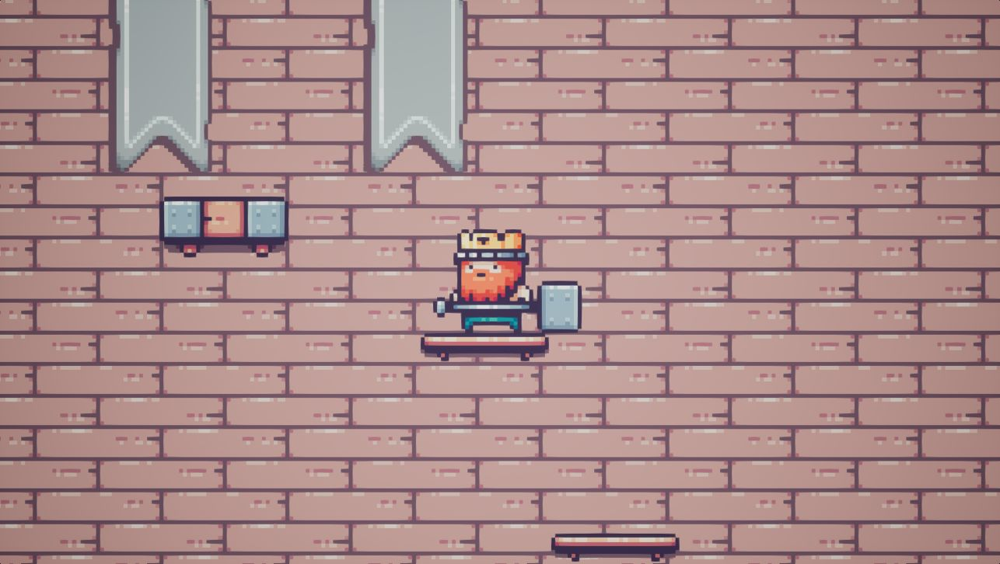

# TowerClimber

**발판을 오르고 적을 피하며 탑 위로 올라가는 2D 플랫폼 게임**입니다.

Unreal Engine 5.6과 Blueprint를 사용해 캐릭터 이동, 점프 판정, 적 AI, 발판 상호작용을 구현했습니다. Paper2D의 픽셀 아트 표현과 PaperZD의 상태 기반 애니메이션을 결합했습니다.

## 스크린샷



## 프로젝트 개요

- **장르:** 2D 플랫폼 / 타워 등반
- **엔진:** Unreal Engine 5.6
- **게임플레이 구현:** Blueprint
- **2D 표현:** Paper2D 스프라이트·플립북·타일맵
- **애니메이션:** PaperZD
- **입력 처리:** Enhanced Input
- **기본 맵:** `MAP_Tower`

## 플레이 방법

- **← / →:** 좌우 이동
- **Space Bar:** 점프
- 발판과 스프링을 이용해 위쪽으로 이동합니다.
- 적을 위에서 밟으면 튕겨 오르며, 적과의 접촉 방향에 따라 패배가 처리됩니다.

입력은 `IA_Move`, `IA_Jump`와 `IMC_Platformer`로 구성되어 있습니다.

## 주요 구현 요소

### 조작감을 보완하는 점프 처리

`BP_King`에서 이동과 점프 입력을 처리하고, 발판을 벗어나는 순간과 착지 직전의 입력을 보완했습니다.

- **코요테 타임:** 발판에서 벗어난 직후에도 짧은 시간 동안 점프를 허용
- **점프 버퍼:** 착지 직전의 점프 입력을 잠시 유지해 입력 타이밍을 보완
- **점프 유지·해제 처리:** `Jump`와 `StopJumping`을 입력 상태에 연결
- **발밑 검사:** 라인 트레이스로 발판을 확인하고 단방향 발판의 충돌 반응 처리

### 캐릭터 공통 동작과 역할 분리

`BP_PlatformerChar`에 공통 패배 상태와 발사 연출을 두고, 플레이어와 적이 이를 공유하도록 구성했습니다.

- `BP_King`: 플레이어 입력, 점프 판정, 적 밟기와 카메라 처리
- `BP_Pig`: 적의 이동 방향 전환, 지형 검사와 충돌 반응
- `AIC_Pig`: 적 캐릭터에 이동 입력을 전달하는 AI 컨트롤러

적은 라인 트레이스로 벽과 낭떠러지를 검사하고 이동 방향을 전환합니다.

### 발판과 스프링 상호작용

- 일반 발판과 단방향 발판을 각각 Blueprint로 구성
- 폭이 다른 발판을 배치해 수직 이동 경로 구성
- `BP_Spring`의 겹침 판정으로 캐릭터를 위쪽으로 발사
- 스프링 작동 시 플립북을 전환하고 재생 종료 후 대기 상태로 복귀

### PaperZD 애니메이션과 피드백

플레이어와 적의 애니메이션을 별도 애니메이션 Blueprint로 관리합니다.

- `ABP_King`: 대기·걷기·점프 상승·낙하·패배 상태
- `ABP_Pig`: 대기·걷기·패배 상태
- 이동 속도와 낙하 여부를 이용한 애니메이션 전환
- 패배 시 캐릭터 발사, 사운드와 카메라 흔들림으로 결과 전달
- 타일맵과 발판 배치로 탑 내부의 수직 레벨 구성

## 실행 방법

**Unreal Engine 5.6과 해당 엔진 버전용 PaperZD 플러그인**이 필요합니다. 프로젝트 설정에서 PaperZD가 활성화되어 있습니다.

1. 저장소를 내려받습니다.

   ```bash
   git clone https://github.com/HRI-GD/TowerClimber.git
   ```

2. Unreal Engine 5.6에 PaperZD 플러그인이 설치되어 있는지 확인합니다.
3. `TowerClimber.uproject`를 Unreal Editor로 엽니다.
4. 기본 맵 `Content/Maps/MAP_Tower`에서 **Play**를 누릅니다.
5. 게임 화면을 클릭해 입력 포커스를 준 뒤 방향키와 Space Bar로 조작합니다.

## 프로젝트 구조

```text
TowerClimber/
├── TowerClimber.uproject
├── Config/                          프로젝트 및 입력 설정
├── Content/
│   ├── AI/AIC_Pig                   적 이동 컨트롤러
│   ├── Blueprints/
│   │   ├── GM_Platformer            기본 게임 모드
│   │   ├── Characters/
│   │   │   ├── BP_PlatformerChar    캐릭터 공통 동작
│   │   │   ├── King/               플레이어와 애니메이션
│   │   │   └── Pig/                적과 애니메이션
│   │   ├── Ledges/                 일반·단방향 발판
│   │   └── Spring/BP_Spring        스프링 상호작용
│   ├── Input/                      입력 액션과 키 매핑
│   ├── Maps/                       타워·디버그 맵
│   ├── PaperAssets/                캐릭터·발판·타일맵 리소스
│   ├── CameraShake/                패배 카메라 연출
│   └── Sounds/                     효과음
└── docs/images/                    README 스크린샷
```

## 구현을 통해 다룬 내용

- 코요테 타임과 점프 버퍼를 활용한 입력 허용 범위 설계
- 라인 트레이스와 충돌 채널을 이용한 지형·발판 판정
- 캐릭터 상속과 AI 컨트롤러를 통한 역할 분리
- PaperZD 상태 머신을 활용한 2D 애니메이션 전환
- 겹침 이벤트와 `LaunchCharacter`를 이용한 적 밟기·스프링 반응
- 사운드와 카메라 연출을 통한 플레이 피드백
